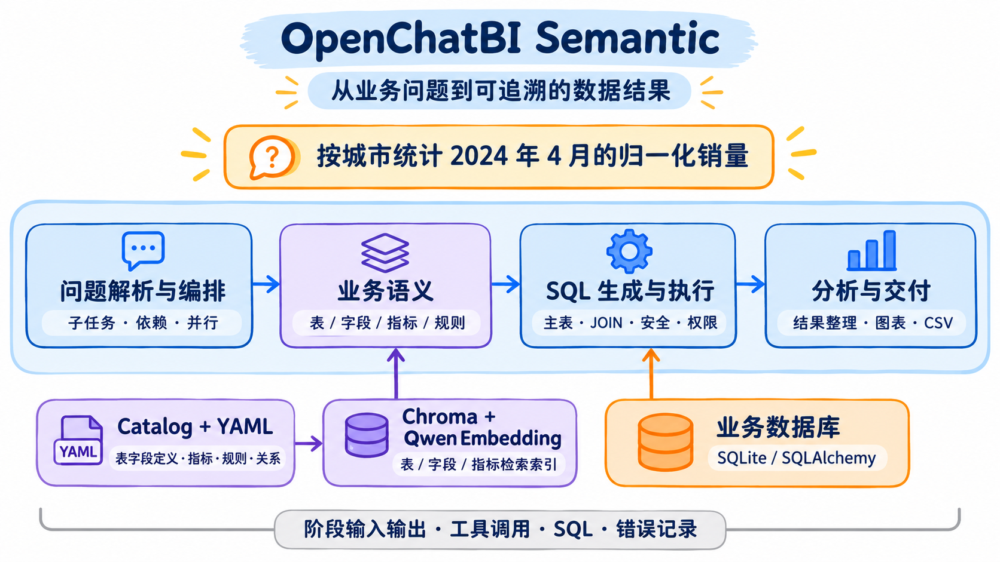

<div align="center">

# OpenChatBI Semantic

**用自然语言查询数据，也看清每一步是怎么得到结果的。**

基于 OpenChatBI 二次开发的语义驱动数据分析工作台。

[快速开始](#快速开始) · [功能演示](#功能演示) · [系统架构](#系统架构) · [已知问题](#已知问题) · [开发路线](#开发路线)

</div>

## 为什么做这个项目

当你问“这个月哪个地区卖得更好”，系统需要先理解销量的口径，找到对应的表和字段，再决定怎样关联、筛选和汇总。最终结果还需要能解释、能核对、能带走。

OpenChatBI Semantic 希望把这个过程呈现出来。你可以在本地工作台提问，查看语义检索、查询计划、SQL 和结果，再继续分析或下载 CSV。接入自己的业务时，可以分别维护数据库连接、字段说明、指标口径和业务规则。

项目目前处于持续开发阶段。我们正在用小型演示库和真实零售数据检验这条链路，也会记录失败案例。例如，数据里只有销量时，系统怎样识别“利润归因”无法完成，怎样及时说明缺少哪些信息，是当前重点完善的问题。

本项目基于 [OpenChatBI](https://github.com/zhongyu09/openchatbi) `v1.0.0b1`，沿用其 Text2SQL、分析能力与 catalog 基础，在此之上建设语义层和分层编排。版权与许可说明见 [NOTICE](NOTICE) 和 [LICENSE](LICENSE)。

## 你可以用它做什么

- **自然语言查数** — 查询趋势、排名、分组统计，查看生成的 SQL、表格和图表。
- **维护业务口径** — 通过配置管理指标、依赖、字段规则与表关系，给查询提供明确的业务上下文。
- **处理多步问题** — 将复杂问题拆成子任务，安排依赖，让独立查询并行执行，再整理分析结果。
- **检查多表关联** — 根据声明的关系选择主表、寻找 JOIN 路径并检查连接键。
- **跟踪执行过程** — 查看任务状态、工具结果、SQL、安全与权限检查，以及阶段输入输出记录。
- **交付查询结果** — 整理真实数据集并导出 CSV，继续在本地分析工具中使用。

## 功能演示

### 从一个问题到查询结果

> **GIF 展示位置** · 提问、语义检索、SQL 生成、数据表和图表。

<!-- 录制完成后，将下面一行移出注释。建议使用真实工作台录屏，宽度约 1200 px。

-->

### 多步对比与 CSV 导出

> **GIF 展示位置** · 独立查询、依赖汇总、结果对比和下载。

<!-- 录制完成后，将下面一行移出注释。

-->

### 系统界面

| 问答工作台 | 执行过程 |
|---|---|
| 截图预留：提问区、结果表和图表 | 截图预留：子任务、语义选择、SQL 与错误说明 |

<!-- 截图补齐后，可替换上面的预留表格。


-->

## 系统架构



架构采用一个外层编排图和三个能力子图。图预先编译，运行时按照任务依赖进行路由和调度。

| 层次 | 主要职责 |
|---|---|
| 问题解析与编排 | 理解问题、拆分子任务、检查计划、安排依赖及并行、汇总结果 |
| 业务理解与语义查询 | 查询表、字段、指标和规则，准备 SQL 所需的业务上下文 |
| SQL 生成与执行 | 选择主表、规划 JOIN、生成 SQL、安全审查、用户权限检查和执行 |
| 数据整理与交付 | 复用分析能力、整理数据、对比结果、生成摘要及 CSV |

**语义层负责字段选择。** 可以使用 MVP 的向量与规则混合评分，也可以使用原有 LLM 选表选字段提示词。指标检索使用纯向量评分，再补充依赖。SQL 层接收选好的字段与口径。

表与字段定义来自 catalog，指标、规则和关系由 YAML/JSON 声明。Chroma 保存这些元数据的检索索引，Qwen Embedding 提供向量；业务数据由 SQL 数据库提供。首次接入时需要准备元数据，后续变更需要同步定义并重建索引。

细节见[四域工作流说明](docs/four-domain-workflow.md)。

## 快速开始

### 准备环境

- Python 3.11 或更高版本，已在 Conda `agent_study` / Python 3.12 环境验证。
- 支持工具调用的聊天模型服务。
- 用于向量索引和相似检索的千问 Embedding 配置。

在仓库根目录执行以下命令，保留原有工作台启动方式。

```powershell
conda activate agent_study
python -m pip install -e .
Copy-Item .env.example .env  # 仅首次创建时执行
```

### 配置模型

在根目录 `.env` 填写自己的服务信息。

```dotenv
OPENAI_API_KEY=你的聊天模型密钥
CHATBI_MODEL=你的聊天模型名称
# 使用自定义兼容接口时，填写供应商提供的地址
OPENAI_BASE_URL=你的聊天模型兼容接口

CHATBI_WORKFLOW_MODE=four_domain
QWEN_EMBEDDING_API_KEY=你的千问向量服务密钥
QWEN_EMBEDDING_BASE_URL=你的千问OpenAI兼容接口
QWEN_EMBEDDING_MODEL=text-embedding-v4
QWEN_EMBEDDING_DIMENSIONS=1024
```

聊天服务与向量服务分别配置密钥和接口。完整变量说明见 [.env.example](.env.example)。

### 构建索引并启动

```powershell
python -m scripts.build_semantic_index
python run_workbench.py
```

打开 **http://localhost:8501**。本地工作台由 Streamlit 和 Python 在同一进程中运行。

未设置 `CONFIG_FILE` 时，启动器准备独立的 `chatbi_mvp` 演示数据库和配置。首次构建索引会调用向量服务。元数据列表和按 ID 查询可以离线执行。

启动后可以先问：

```text
有哪些表？
有哪些指标？
按国家统计收入。
```

`8501` 端口被占用时，检查已有工作台进程。修改模型、业务配置或 `.env` 后，重启工作台加载新配置。

## 接入你的数据

### 分别管理连接、知识和索引

通过 `CONFIG_FILE` 选择业务入口。工作台与索引构建命令使用同一份配置。

| 配置 | 示例文件 | 管理内容 |
|---|---|---|
| 应用入口 | [config.yaml](example/deployment/config.yaml) | 模型、工作流、权限及报告目录 |
| 业务数据库 | [database.yaml](example/deployment/database.yaml) | SQL 方言、连接串 |
| 业务知识包 | [business.yaml](example/deployment/business.yaml) | catalog、指标、规则及 JOIN 关系 |
| 检索服务 | [retrieval.yaml](example/deployment/retrieval.yaml) | Chroma 路径、附加检索说明 |
| 本地环境 | [.env.example](.env.example) | 密钥、模型服务及数据库连接变量 |

入口通过 `includes` 按顺序合并配置，入口自身最后覆盖。字典递归合并，列表整体替换；组合配置的相对文件路径以声明文件为基准。SQL URI 保留原值，SQLite 建议填写绝对路径。支持 `${ENV_NAME}` 注入，缺失变量会报错。

已有演示业务包可以这样启用。首次先执行 `python -m scripts.run_semantic_demo` 准备演示数据库和 catalog，再在 `.env` 设置：

```dotenv
CONFIG_FILE=example/deployment/config.yaml
CHATBI_DATABASE_URI=sqlite:///D:/path/to/openchatbi/data/semantic_demo/demo.sqlite
```

接入新业务时，需要让数据库结构、catalog、指标、规则、关系和授权相互匹配，并为它指定独立索引目录。数据库中存在的字段，其业务含义仍需要在定义中确认。

### 使用 FreshRetailNet 真实零售数据

项目提供 [FreshRetail 业务包](example/freshretail/config.yaml)和[导入脚本](scripts/import_freshretail.py)，用于检验真实数据接入、多表关联和查询口径。

| 项目 | 数据情况 |
|---|---|
| 来源 | 叮咚买菜官方 FreshRetailNet-50K |
| 时间 | 2024-03-28 至 2024-07-02 |
| 日销售记录 | 485 万行，包含 train 和 eval 分片 |
| 数据模型 | `daily_sales`、`stores`、`products` |
| 基础指标 | 归一化销量、缺货小时数、平均折扣系数、范围内门店数 |

数据和字段说明见[官方数据页](https://huggingface.co/datasets/Dingdong-Inc/FreshRetailNet-50K)。`sale_amount` 表示归一化销量，数据缺少价格、成本和费用，利润分析需要补充对应来源。

将 `train.parquet` 和 `eval.parquet` 放到 `data/freshretailnet_50k/data/` 后执行：

```powershell
python -m pip install pyarrow  # 环境缺少 Parquet 依赖时安装
python -m scripts.import_freshretail
```

脚本分批导入独立 SQLite，保留来源标记，将小时数组保存为 JSON，并提取门店和商品维表。在 `.env` 选择业务配置，按本机位置修改路径：

```dotenv
CONFIG_FILE=example/freshretail/config.yaml
CHATBI_DATABASE_URI=sqlite:///D:/path/to/openchatbi/data/freshretail/freshretail.sqlite
```

```powershell
python -m scripts.build_semantic_index
python run_workbench.py
```

可以尝试这些问题：

```text
按城市统计2024年4月的归一化销量。
2024年4月每日归一化销量趋势如何？
按商品一级分类统计2024年5月的缺货小时数。
```

## 已知问题

我们把数据接入和真实问答中的失败也作为开发依据。以下问题仍在完善中。

| 问题 | 当前表现 | 后续处理方向 |
|---|---|---|
| 语义可满足性判断 | 找到相关表后，仍可能遗漏“缺少所需指标或计算依赖”的判断 | 区分检索未命中、定义未构建和数据确实缺失，给出明确状态 |
| 无法回答时的 SQL 恢复 | 模型返回 `NULL` 后可能被当作 SQL 错误重试，最终产生空列或强制空结果 | 单独处理无法回答状态，阻断无依据的下游分析 |
| 候选表范围 | 相关表可能召回过多，增加上下文和关联复杂度 | 按必需字段及实际关系收敛选表与 JOIN |
| 元数据与真实库同步 | 当前主要依据离线 catalog 和索引，数据库结构变化需要同步 | 增加接入检查、结构差异检测和更新流程 |
| 查询效果验证 | 工程测试覆盖执行与边界，真实问题仍可能受模型和口径影响 | 积累跨数据源问题集、标准 SQL 与结果评测 |

FreshRetail 的 Q1、Q3 只覆盖部分日期，季度对比需说明观察范围。当前身份和权限由可信运行配置提供，登录、SSO、行级权限仍在开发规划中。

## 开发路线

### 已完成

- [x] 四域 LangGraph 编排、依赖引用和独立任务并行。
- [x] 表、字段、指标及业务规则工具，字段混合评分与 LLM 选择。
- [x] 关系图 JOIN 规划、SQL 只读审查与本地表列授权。
- [x] 数据集引用、CSV 下载、阶段记录和计划校验反馈。
- [x] 数据库、业务知识包与 Chroma 的配置解耦。
- [x] FreshRetailNet 导入及独立业务包，真实向量服务联调。

### 近期重点

- [ ] 完成语义可满足性检查，输出可执行、需澄清和缺少定义等状态。
- [ ] 区分无法回答与可恢复的 SQL 错误，完善跨层失败处理。
- [ ] 完善数据库接入检查和元数据同步。
- [ ] 收敛候选表，增加 JOIN 路径与结果粒度评测。
- [ ] 补充真实系统截图、GIF 演示和端到端问题集。

### 后续探索

- [ ] 构建业务知识包的离线生成、人工确认和版本管理流程。
- [ ] 扩展跨来源、多步指标计算及更完整的分析交付。
- [ ] 按能力域接入 PDF、图片理解、WebRAG 等工具。
- [ ] 增加用户认证、SSO 和行级权限。
- [ ] 单独推进指标巡检和 RL 增强服务。

## 开发与验证

最近一次本地完整回归为 **1010 passed / 2 skipped**，运行于 Conda `agent_study`，记录日期为 **2026-11-18**。真实千问索引与检索已联调；复杂业务问答效果继续通过问题集和手动验证积累。

```powershell
python -m pytest tests -q -o addopts=""
python -m pytest tests/workflow -q -o addopts=""
python scripts/validate_semantic_data.py --strict
```

阶段记录位于 `report_directory/.runs/<request_id>/events.jsonl`。可通过以下命令检查执行前的安全与权限证据，并按需传入 `--gold` 对比标准输出。

```powershell
python -m scripts.evaluate_workflow_run <运行目录>
```

更多资料：

- [四域工作流与手动验收](docs/four-domain-workflow.md)
- [语义层验收记录](docs/semantic-acceptance.md)
- [开发记录](docs/plan-notes.md)
- [分析 Agent 说明](openchatbi/analysis/README.md)
- [上游使用参考](docs/upstream-usage.md)

## 参与贡献

欢迎提交失败案例、数据接入经验、业务知识包和代码改进。报告问题时，附上问题原文、使用的数据源、预期结果、实际结果及已脱敏的阶段记录，会更容易复现和定位。

本地 `.env`、下载数据、数据库、Chroma 索引和生成报告由 Git 忽略。提交代码和业务配置前，请检查其中的凭据与业务敏感信息。

## 致谢与许可

感谢 [OpenChatBI](https://github.com/zhongyu09/openchatbi) 提供项目基础，以及 LangGraph、LangChain、Chroma 和相关开源工具的贡献者。FreshRetailNet 数据由叮咚买菜发布，使用时请遵循数据集自己的许可和引用要求。

代码采用 **MIT License**，保留上游与二开作者版权声明，详见 [LICENSE](LICENSE) 和 [NOTICE](NOTICE)。
